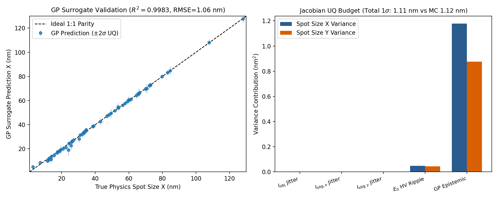
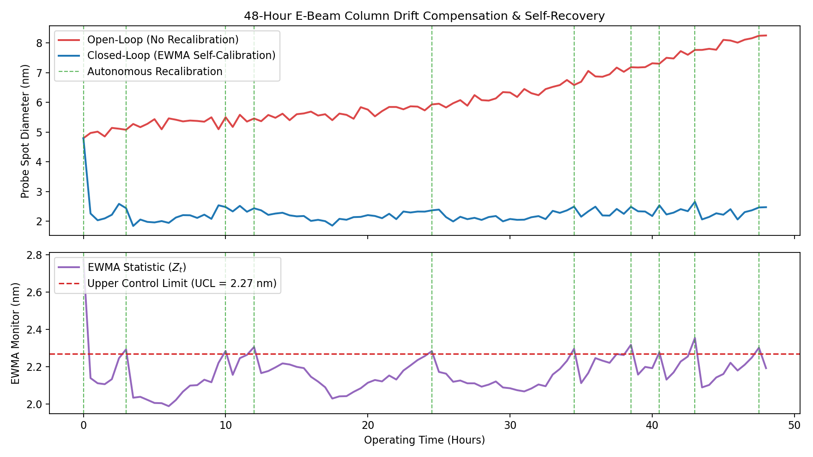

# Physics-Informed Surrogate Modeling, UQ & Autonomous Calibration for Electron-Optical Columns

A modular scientific machine learning and numerical optimization framework for calibrating and monitoring scanning electron-beam (e-beam) inspection columns under thermal drift, high-voltage instability, and measurement noise.

---

## 1. Engineering Motivation
High-resolution e-beam wafer inspection and metrology systems require nanometer-scale probe stability across changing landing energies and extended tool operation. Exhaustive grid sweeps across objective lenses, stigmators, and deflectors degrade fab throughput, while uncompensated thermal expansion and high-voltage (HV) drift gradually enlarge probe spot size and degrade image contrast.

This repository implements an end-to-end calibration and fleet-monitoring pipeline:
1. **Physics Forward Model (`physics_column.py`):** Simulates paraxial electron-optical focusing, spherical ($C_s$) and chromatic ($C_c$) aberrations, parasitic X/Y astigmatism, 2D deflector rotation/pincushion distortion, and time-dependent thermal/HV drift.
2. **GP Surrogate & Jacobian UQ (`surrogate_and_uq.py`):** Trains a multi-output Gaussian Process surrogate (`Matérn 5/2` ARD kernel) on Latin Hypercube Design of Experiments (DoE) runs, quantifying epistemic uncertainty and propagating actuator jitter via first-order Jacobians ($\Sigma_y = J \Sigma_x J^T + \Sigma_{\text{GP}}$) cross-checked against Monte Carlo sampling.
3. **Uncertainty-Aware Calibration & EWMA Drift Control (`calibrate_and_monitor.py`):** Recovers optimal lens and stigmator currents via multi-start `L-BFGS-B` with an Upper Confidence Bound (UCB) risk penalty, calibrates 2D deflector field distortion via least squares, and uses an Exponentially Weighted Moving Average (EWMA) control chart to trigger autonomous self-calibration.

---

## 2. Mathematical Formulation

### Forward Probe Resolution & Deflection Model
Total 1-$\sigma$ electron probe diameters $\sigma_{x,y}$ combine the demagnified source size $\sigma_0$, defocus blur, spherical aberration, chromatic aberration, and residual astigmatism in quadrature:

$$\sigma_{x,y} = \sqrt{\sigma_0^2 + d_{\text{defocus}}^2 + d_s^2 + d_c^2 + d_{\text{ast},x/y}^2} + \epsilon_{\text{meas}}$$

where $d_s = \frac{1}{2} C_s \alpha^3$, $d_c = C_c \frac{\Delta E}{E_0} \alpha$, and target objective excitation scales with landing energy as $I_{\text{opt}}(E_0) = I_{\text{opt},0}\sqrt{E_0 / E_{\text{ref}}}$.

### Surrogate Uncertainty Propagation & EWMA Control
Given nominal actuator settings $\mathbf{x}_0$ and actuator jitter covariance $\Sigma_x$, output spot-size covariance combines linearized sensitivity propagation with GP posterior variance:

$$\Sigma_y = J(\mathbf{x}_0)\,\Sigma_x\,J(\mathbf{x}_0)^T + \operatorname{diag}\!\left(\sigma_{\text{GP},x}^2(\mathbf{x}_0),\, \sigma_{\text{GP},y}^2(\mathbf{x}_0)\right)$$

During wafer-lot operation, residual spot-size degradation is tracked via an EWMA statistic $Z_t = \lambda d_t + (1 - \lambda) Z_{t-1}$, triggering rapid local recalibration whenever $Z_t$ exceeds the Upper Control Limit $\text{UCL} = d_0 + L\sigma_{\text{meas}}\sqrt{\frac{\lambda}{2 - \lambda}}$.

---

## 3. Diagnostic Results

### Surrogate Accuracy & Jacobian Uncertainty Budget


### 48-Hour Thermal/HV Drift Compensation & Self-Recovery


---

## 4. Quickstart

```bash
pip install -r requirements.txt
python physics_column.py
python surrogate_and_uq.py
python calibrate_and_monitor.py